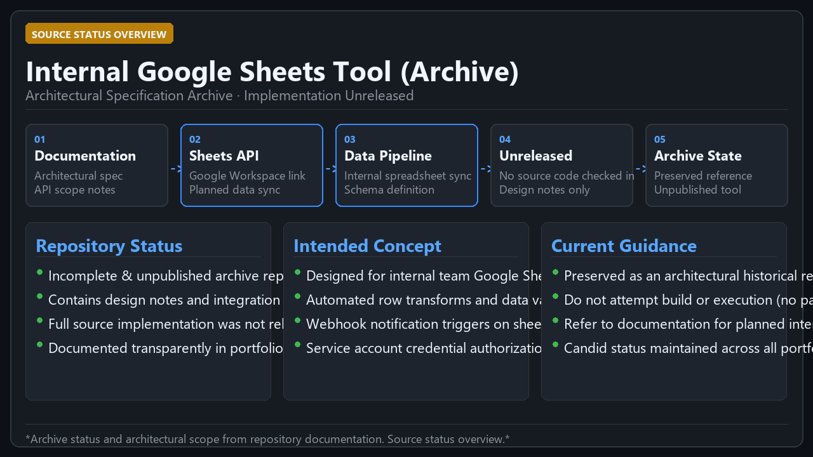

# InternalGoogleSheetsTool

*Click preview above to view source status overview.*

**A project name with no recovered tool behind it yet.** This repository is a clear signpost: it records what could be verified and avoids pretending there is something to install.

## Source status

This repository contains no application source, setup instructions, or documented capabilities. No source was recovered from the local project folders or Google Drive during the README review, so its purpose and behavior cannot be described reliably and there is nothing runnable here yet.
